<!-- ============================================================
     Profile README for github.com/kritisubedi1
     Repo must be named: kritisubedi1/kritisubedi1
     header.svg sits in the repo root
     Replace every YOUR_... placeholder before publishing.
     ============================================================ -->

 

  

---

### Hi, I'm Kriti 👋

I'm a **Software Engineering master's student at Memorial University of Newfoundland** who builds production web applications, backend services, APIs, and AI-enabled systems. I like taking a messy real-world problem and turning it into software that's **maintainable, tested, and actually shipped** — from implementation and code review through deployment and iteration.

- 🎓 **Studying** — MASc in Software Engineering, Memorial University of Newfoundland
- 💼 **Recently** — Full Stack Developer Intern at **EsseReale Robotics**, building the Yo-Go mobility platform
- 🤖 **Building** — ClearTech, a fairness-aware AI technical interview coach
- 🌱 **Leveling up** — Advanced Java, system design, distributed systems, RAG & vector search
- 💬 **Ask me about** — Spring Boot APIs, Next.js front ends, NLP pipelines, software verification & validation
- 📍 **Based in** — Newfoundland and Labrador, Canada 🇨🇦

---

## 🛠️ Engineering Stack

<table>
  <tr>
    <td width="140"><b>Backend</b></td>
    <td>&nbsp; REST APIs · Spring Security · JPA · Hibernate</td>
  </tr>
  <tr>
    <td><b>Frontend</b></td>
    <td></td>
  </tr>
  <tr>
    <td><b>Data</b></td>
    <td></td>
  </tr>
  <tr>
    <td><b>AI / ML</b></td>
    <td>&nbsp; NLP · LLM Integration · TF-IDF</td>
  </tr>
  <tr>
    <td><b>Cloud & DevOps</b></td>
    <td>&nbsp; CI/CD</td>
  </tr>
  <tr>
    <td><b>Testing</b></td>
    <td>JUnit · Mockito · API Testing · Software Verification & Validation</td>
  </tr>
  <tr>
    <td><b>Tools</b></td>
    <td></td>
  </tr>
</table>

---

## 🚀 Selected Work

<table>
  <tr>
    <td width="50%" valign="top">
      <h3>🤖 ClearTech</h3>
      <b>FAIRNESS-AWARE TECHNICAL INTERVIEW COACH</b>
      
AI-assisted interview platform that scores <b>technical-answer quality separately from communication delivery</b>, so strong engineers aren't penalized for accent or speaking style.

      <ul>
        <li>Audio-based interview sessions</li>
        <li>AI answer evaluation + communication analysis</li>
        <li>Automated session reports</li>
      </ul>
      
      
      
        
      <a href="https://github.com/kritisubedi1/YOUR_CLEARTECH_REPO"><b>View repo →</b></a>
    </td>
    <td width="50%" valign="top">
      <h3>🔍 Review Guard</h3>
      <b>FAKE REVIEW DETECTION</b>
      
ML system that classifies online reviews as <b>genuine or fake</b>, with a clean preprocessing pipeline and an API for single and batch predictions.

      <ul>
        <li>TF-IDF features + multiple classifiers compared</li>
        <li>Single &amp; batch prediction endpoints</li>
        <li>Model evaluation and comparison</li>
      </ul>
      
      
      
        
      <a href="https://github.com/kritisubedi1/YOUR_REVIEWGUARD_REPO"><b>View repo →</b></a>
    </td>
  </tr>
  <tr>
    <td width="50%" valign="top">
      <h3>♟️ Chess IntelliPlay</h3>
      <b>ALGORITHMS · DECISION-MAKING</b>
      
Interactive web app exploring intelligent move selection and pathfinding algorithms in the browser.

      
      
        
      <a href="https://github.com/kritisubedi1/YOUR_CHESS_REPO"><b>View repo →</b></a>
    </td>
    <td width="50%" valign="top">
      <h3>🛒 MUN Marketplace</h3>
      <b>COMMUNITY LISTINGS</b>
      
Marketplace-style web app for browsing and interacting with local listings in the MUN community.

      
      
      
        
      <a href="https://github.com/kritisubedi1/YOUR_MARKETPLACE_REPO"><b>View repo →</b></a>
    </td>
  </tr>
</table>

---

## 💼 Experience

<table>
  <tr>
    <td>
      <b>Full Stack Developer Intern</b> · <a href="#">EsseReale Robotics</a> 
      Production web platform for the <b>Yo-Go</b> mobility product
        

- Built and refined **responsive interfaces** with Next.js, React, TypeScript, and Tailwind CSS
- Shipped through a real team workflow — **feature branches, issues, PRs, and code review**
- Contributed to **CMS-driven content workflows** and production website improvements
- Built product-focused **visual storytelling and interactive** web experiences
- Took part in **testing and deployment** workflows

   
    </td>
  </tr>
</table>

---

## 🧠 What I'm Building Toward

---

## 📊 GitHub Activity

---

## 🤝 Let's Connect

I'm open to **software engineering, backend, full-stack, and AI-application roles**, plus technical collaborations. If you're hiring or building something interesting, I'd love to hear from you.

